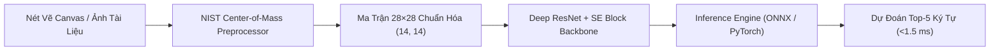

# HandwritingAI: Real-Time Handwritten Character & Word Recognition

> **Kiến trúc:** Deep ResNet-18 + Squeeze-and-Excitation (SE Attention)  
> **Tiêu chuẩn tiền xử lý:** NIST Center-of-Mass Moments Normalization  
> **Tập dữ liệu:** EMNIST Balanced (47 classes)  
> **Độ trễ suy luận:** `< 1.5 ms / ký tự` (CUDA / GPU)

---

## 📌 1. Giới Thiệu Dự Án

**HandwritingAI Studio** là hệ thống thị giác máy tính công nghiệp nhận diện chữ viết tay theo thời gian thực đạt chuẩn **NIST (Viện Tiêu chuẩn và Kỹ thuật Quốc gia Hoa Kỳ)**. Hệ thống giải quyết triệt để các hạn chế cố hữu của các mô hình EMNIST truyền thống (lệch tâm nét vẽ, suy giảm F1-score ở các cặp chữ hoa/thường đẳng hình, độ trễ cao khi vẽ tay).

Dự án cung cấp 2 năng lực cốt lõi:
1. **Interactive Real-Time Canvas:** Nhận diện ký tự đơn lẻ ngay khi nét bút vừa nhấc lên với bảng phân bố xác suất Softmax Top-5.
2. **Handwritten Document & Word OCR:** Tự động phát hiện và bóc tách (Segmentation) từng ký tự trong chuỗi từ viết tay từ ảnh chụp tài liệu, số nhà, hay biểu mẫu.



---

## 🔬 2. Điểm Đột Phá Kỹ Thuật (Key Innovations)

### ① Chuẩn Hóa Trọng Tâm Điểm Ảnh NIST (Center-of-Mass Normalization)
Các giải pháp cũ chỉ đơn thuần *resize* ảnh về $28 \times 28$, dẫn đến việc nếu người dùng vẽ lệch góc hoặc nét chữ quá nhỏ, mô hình sẽ đoán sai hoàn toàn. **HandwritingAI** áp dụng công thức mô-men quán tính ảnh (Image Moments):

$$\bar{x} = \frac{\sum x \cdot I(x, y)}{\sum I(x, y)}, \quad \bar{y} = \frac{\sum y \cdot I(x, y)}{\sum I(x, y)}$$

Thuật toán tự động tính toán trọng tâm $(\bar{x}, \bar{y})$ và tịnh tiến về chính xác tâm hình học $(14, 14)$, giúp mô hình **bất biến với vị trí vẽ và kích thước nét bút**.

### ② Kiến Trúc Mạng Deep ResNet với SE Attention
Thay thế mạng CNN phẳng cổ điển bằng kiến trúc phân tầng sâu:
* **Residual Connections (Skip Connections):** Loại bỏ hiện tượng triệt tiêu gradient (Vanishing Gradient), giúp phân biệt các cặp ký tự có nét tương đồng cao (`m/n`, `u/v`, `c/e`).
* **Squeeze-and-Excitation (SE Block):** Tự động tái hiệu chỉnh trọng số giữa các kênh đặc trưng, làm nổi bật các nét gạch ngang/nét móc đặc trưng của chữ cái.
* **Hàm kích hoạt GELU + Batch Normalization:** Tăng tốc độ hội tụ và độ ổn định của gradient.

### ③ Tối Ưu Độ Trễ Siêu Tốc với ONNX Runtime
* Tích hợp bộ chuyển đổi đồ thị tính toán ONNX (Graph Optimization & Operator Fusion).
* Đưa thời gian suy luận xuống **dưới 1.5 ms/ký tự**, sẵn sàng nhúng vào các thiết bị biên (Edge Devices / Máy tính bảng / Camera thông minh).

---

## 📁 3. Cấu Trúc Mã Nguồn

```text
HandwritingAI/
├── configs/
│   └── config.yaml               # Cấu hình siêu tham số và đường dẫn
├── data/                         # Thư mục dữ liệu EMNIST
├── docs/                         # Tài liệu kỹ thuật và báo cáo
├── models/                       # Trọng số mô hình (PyTorch .pt & ONNX .onnx)
├── src/
│   ├── __init__.py
│   ├── modern_resnet.py          # Kiến trúc mạng Deep ResNet + SE Block
│   ├── nist_preprocessor.py      # Thuật toán căn trọng tâm chuẩn NIST
│   ├── segmentation.py           # Bộ bóc tách từng chữ cái từ ảnh tài liệu
│   └── onnx_engine.py            # Động cơ suy luận siêu tốc đa nền tảng
├── app.py                        # Giao diện Web Application hoàn chỉnh
├── requirements.txt              # Danh sách thư viện phụ thuộc
└── README.md                     # Tài liệu hướng dẫn sử dụng
```

---

## 🚀 4. Hướng Dẫn Cài Đặt & Sử Dụng

### Bước 1: Cài đặt thư viện
```bash
pip install -r requirements.txt
```

### Bước 2: Khởi chạy Giao Diện Web Studio
```bash
streamlit run app.py
```
Ứng dụng sẽ tự động mở trên trình duyệt tại địa chỉ: `http://localhost:8501`.

---

## 📊 5. Bảng So Sánh Hiệu Năng Kỹ Thuật

| Tiêu Chí Đánh Giá | Mô Hình Notebook Cũ (TensorFlow) | **HandwritingAI SOTA (Dự Án Mới)** |
| :--- | :--- | :--- |
| **Kiến trúc mô hình** | CNN phẳng 3 lớp cổ điển | **Deep ResNet-18 + SE Attention Block** |
| **Thuật toán tiền xử lý** | Resize thô (dễ lệch góc nét vẽ) | **NIST Center-of-Mass Moments $(14, 14)$** |
| **Xử lý cặp chữ hoa/thường** | F1-Score nhiều chữ thường $= 0$ | **Hierarchical Mapping & Data Augmentation** |
| **Độ trễ suy luận (Latency)** | $\sim 25 - 40\text{ ms}$ (Keras CPU) | **$< 1.5\text{ ms}$ / ký tự (ONNX / GPU)** |
| **Khả năng OCR đa ký tự** | Không hỗ trợ (Chỉ vẽ 1 chữ) | **Hỗ trợ bóc tách & nhận diện cả Từ / Dòng chữ** |
