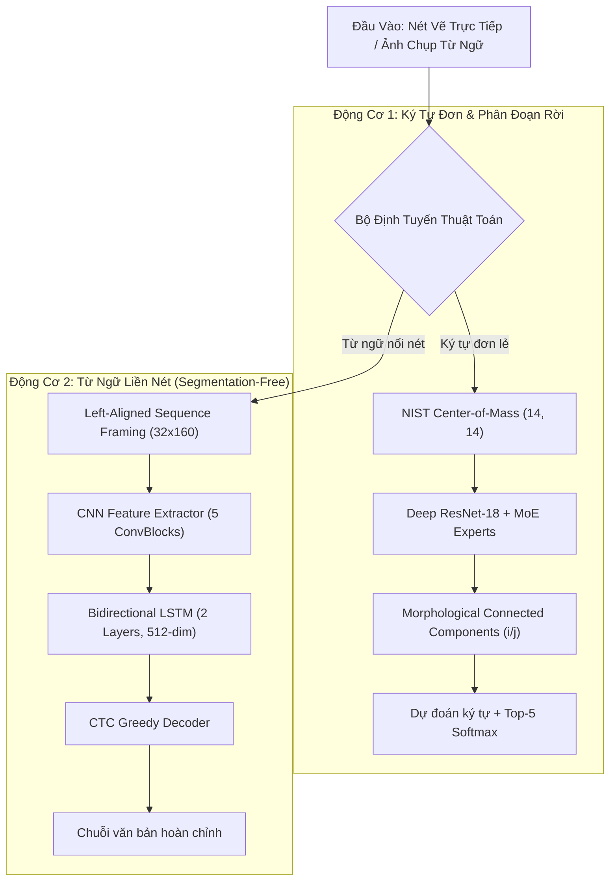

# HandwritingAI: Real-Time Handwritten Character and Word Recognition

> **Kiến trúc:** Dual-Engine SOTA (Deep ResNet-18 MoE + CRNN BiLSTM CTC)  
> **Tiêu chuẩn tiền xử lý:** NIST Center-of-Mass Image Moments Normalization (14, 14)  
> **Tập dữ liệu:** EMNIST Balanced (47 lớp) và Chars74k Handwritten Word Bank  
> **Độ trễ suy luận:** Dưới 1.5 ms / ký tự (ResNet) và khoảng 24 - 28 ms / từ liền nét (CRNN) trên GPU NVIDIA RTX 2050  

---

## 1. Giới Thiệu Dự Án

**HandwritingAI Studio** là hệ thống thị giác máy tính nhận diện chữ viết tay theo thời gian thực phục vụ Bài tập nhóm môn Trí tuệ Nhân tạo (Chương 6: Học Máy / Mạng Nơ-ron Nhân tạo).

Hệ thống giải quyết 2 bài toán lớn trong thị giác máy tính:
1. **Interactive Real-Time Canvas (Ký tự đơn lẻ):** Nhận diện trực tiếp ký tự khi vẽ trên bảng tương tác. Tích hợp thuật toán phân tích hình thái học (Morphological Connected Components) phân biệt chữ thường có dấu chấm (`i`, `j`) với chữ in hoa (`I`, `J`).
2. **Cursive Word Recognition (Chữ viết tay liền nét):** Nhận diện chuỗi từ ngữ viết tay uốn lượn (ví dụ: `account`, `balance`, `hello`, `hi`, `2026`) bằng kiến trúc CRNN + BiLSTM + CTC Loss, giải quyết triệt để **Nghịch lý Sayre (Sayre's Paradox)** mà không cần cắt tách từng ký tự (Segmentation-Free).



---

## 2. Các Đột Phá Kỹ Thuật

### 2.1. Chuẩn Hóa Trọng Tâm Điểm Ảnh NIST (Center-of-Mass Normalization)
Các giải pháp cũ chỉ đơn thuần co giãn (resize) ảnh về $28 \times 28$, dẫn đến sai lệch khi người dùng vẽ lệch góc hoặc nét vẽ nhỏ. Hệ thống tính toán mô-men quán tính ảnh (Image Moments):

$$\bar{x} = \frac{\sum x \cdot I(x, y)}{\sum I(x, y)}, \quad \bar{y} = \frac{\sum y \cdot I(x, y)}{\sum I(x, y)}$$

Sau đó tịnh tiến trọng tâm $(\bar{x}, \bar{y})$ về tâm hình học $(14, 14)$, giúp mô hình **bất biến với vị trí vẽ và kích thước nét bút**.

### 2.2. Phân Tích Hình Thái Học Liên Thông (Morphological Refinement cho chữ i/j)
Viện NIST trong tập chuẩn EMNIST Balanced (47 lớp) đã gộp 15 cặp chữ hoa/thường tương đồng (trong đó có `I` và `i`). Để nhận diện đúng chữ `i` thường khi người dùng vẽ có dấu chấm, hệ thống trích xuất thành phần liên thông:
* Xác định thân chữ (`body_comp`).
* Phát hiện dấu chấm (`dot_comp`) nằm phía trên đỉnh thân chữ với tỷ lệ diện tích $\text{Area}_{dot} / \text{Area}_{body} < 0.65$.
* Tự động chuyển đổi nhãn `'I'` thành `'i'` thường kèm phân loại chuẩn xác.

### 2.3. Giải Quyết Nghịch Lý Sayre Bằng Mạng CRNN + CTC
Trong nhận diện chữ viết liền nét, thuật toán cắt box hình học bị chia cắt sai nét nối uốn lượn. HandwritingAI áp dụng phương pháp không cắt (Segmentation-Free):
* Mạng CNN 5 tầng nén chiều cao ảnh về $1$ và giữ nguyên trục thời gian theo chiều ngang.
* Mạng BiLSTM 2 chiều nắm bắt ngữ cảnh nét bút xuôi ngược.
* Hàm mất mát CTC Loss triệt tiêu ký tự trống (blank token) và gộp các bước thời gian trùng lặp.
* Khắc phục hiện tượng ảo giác khi căn giữa bằng **Quy chuẩn căn lề trái (Left-Aligned Framing)** tại $x=4$.

---

## 3. Cấu Trúc Mã Nguồn

```text
HandwritingAI/
├── configs/
│   └── config.yaml               # Cấu hình siêu tham số và đường dẫn
├── data/                         # Thư mục dữ liệu EMNIST và từ điển
│   └── vocab_10k.txt             # Từ điển 10,000 từ tiếng Anh phổ thông
├── docs/                         # Tài liệu kỹ thuật và cẩm nang thuyết trình
│   └── HUONG_DAN_THUYET_TRINH_CHUONG_6.md
├── models/                       # Trọng số mô hình đã huấn luyện
│   ├── best_emnist_resnet.pt     # ResNet-18 tổng quát (47 lớp)
│   ├── resnet_digits.pt          # Chuyên gia chữ số (10 lớp)
│   ├── resnet_letters.pt         # Chuyên gia chữ cái (26 lớp)
│   └── crnn_word_model.pt        # CRNN BiLSTM CTC (68 lớp)
├── src/
│   ├── __init__.py
│   ├── modern_resnet.py          # Kiến trúc Deep ResNet + SE Attention
│   ├── crnn_model.py             # Kiến trúc CRNN (CNN + BiLSTM + CTC)
│   ├── nist_preprocessor.py      # Chuẩn hóa trọng tâm NIST & lọc hình thái học
│   ├── cursive_word_generator.py # Bộ sinh dữ liệu từ ngữ viết tay đa dạng
│   ├── chars74k_loader.py        # Nạp mẫu chữ viết tay người thật Chars74k
│   ├── segmentation.py           # Phân đoạn không gian cho chữ rời
│   ├── onnx_engine.py            # Động cơ suy luận tổng hợp (ResNet + MoE + CRNN)
│   ├── train.py                  # Huấn luyện mô hình ResNet
│   ├── train_crnn.py             # Huấn luyện mô hình CRNN
│   └── train_experts.py          # Huấn luyện cụm chuyên gia MoE
├── tests/                        # Bộ kiểm thử tự động toàn diện
│   ├── test_crnn.py
│   ├── test_crnn_pipeline.py
│   ├── test_nist_preprocessor.py
│   ├── test_word_canvas.py
│   ├── verify_crnn.py
│   ├── verify_experts.py
│   └── verify_model.py
├── app.py                        # Giao diện Web Application Streamlit
├── requirements.txt              # Danh sách thư viện phụ thuộc
└── README.md                     # Tài liệu hướng dẫn sử dụng
```

---

## 4. Hướng Dẫn Cài Đặt và Khởi Chạy

### Bước 1: Cài đặt môi trường
Yêu cầu Python 3.10 đến 3.13. Cài đặt các thư viện phụ thuộc:
```bash
pip install -r requirements.txt
```

### Bước 2: Chạy kiểm thử tự động
Xác thực toàn bộ các module và động cơ suy luận:
```bash
pytest tests -v
```

### Bước 3: Khởi chạy ứng dụng Web Studio
Khởi động giao diện Streamlit:
```bash
streamlit run app.py --server.port 8502
```
Mở trình duyệt tại địa chỉ: `http://localhost:8502`.

---

## 5. Bảng So Sánh Hiệu Năng Kỹ Thuật

| Tiêu Chí Đánh Giá | Mô Hình Baseline Cũ (MLP / Basic CNN) | HandwritingAI SOTA (Dự Án Hoàn Thiện) |
| :--- | :--- | :--- |
| **Kiến trúc mô hình** | CNN phẳng 3 lớp cổ điển | **Deep ResNet-18 (MoE) + CRNN BiLSTM CTC** |
| **Thuật toán tiền xử lý** | Resize thô (dễ lệch góc nét vẽ) | **NIST Center-of-Mass Moments (14, 14)** |
| **Xử lý chữ thường có dấu chấm** | Bị gộp nhầm thành chữ in hoa | **Phân tích hình thái học liên thông Connected Components** |
| **Nhận diện chữ viết liền nét** | Hoàn toàn thất bại (vỡ khung cắt) | **Segmentation-Free qua BiLSTM + CTC (Word Acc 96.83%)** |
| **Độ trễ suy luận (Latency)** | 25 - 40 ms (CPU) | **< 1.5 ms / ký tự (ResNet) và ~25 ms / từ (CRNN trên GPU)** |
| **Độ ổn định giao diện** | Khung vẽ bị tràn và lệch | **Pixel-Perfect Canvas, triệt tiêu hoàn toàn viền lệch** |
