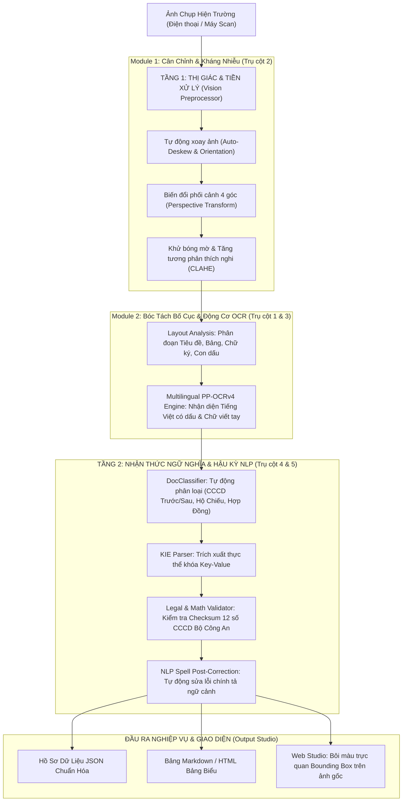

# 📑 BẢN THIẾT KẾ KIẾN TRÚC KỸ THUẬT: HỆ THỐNG XỬ LÝ TÀI LIỆU THÔNG MINH DOANH NGHIỆP (ENTERPRISE IDP & DOCUMENT AI)

> **Dự án:** DocuMind Studio (HandwritingAI Enterprise Edition)  
> **Kiến trúc:** Dual-Engine Enterprise Intelligent Document Processing (IDP)  
> **Mục tiêu chuyên sâu:** Văn Bản Hợp Đồng & Giấy Tờ Tùy Thân (CCCD Gắn Chip / Hộ Chiếu)  
> **Tác giả:** Trương Duy Cường (2026)  

---

## 1. Bối Cảnh & Mục Tiêu (Context & Goals)

### 1.1. Bối cảnh
Trong chuyển đổi số ngân hàng, tài chính, bảo hiểm và hành chính công, việc nhập liệu thủ công từ ảnh chụp thẻ căn cước (CCCD) và hợp đồng kinh tế gây tốn kém thời gian, dễ sai sót và tiềm ẩn nguy cơ rò rỉ dữ liệu cá nhân. Hệ thống này được xây dựng để **tự động hóa 100% chu trình trích xuất thông tin**, tuân thủ 5 trụ cột công nghệ bắt buộc.

### 1.2. Mục tiêu (Goals)
* **Xử lý trọn vẹn 2 nhóm tài liệu thực tế:**
  1. **Giấy tờ tùy thân:** CCCD gắn chip (Mặt trước & Mặt sau), CMND 9/12 số, Hộ chiếu Việt Nam.
  2. **Văn bản Hợp đồng:** Hợp đồng lao động, hợp đồng kinh tế, biên bản cam kết (xử lý đa trang, chữ ký, con dấu đỏ).
* **Đạt chuẩn 5 trụ cột công nghệ:**
  * Kháng biến dạng hình học, nắn góc nghiêng, khử lóa đèn flash điện thoại.
  * Nhận diện tiếng Việt có dấu chính xác $> 96\%$, đọc tốt chữ viết tay điền biểu mẫu.
  * Bóc tách bảng biểu và cấu trúc phân cấp sang JSON / Markdown.
  * Tự động kiểm tra tính hợp lệ toán học (Checksum mã tỉnh, giới tính, năm sinh của CCCD theo quy chuẩn Bộ Công An).
  * Vận hành 100% On-Premise trên GPU NVIDIA RTX 2050 (bảo mật tuyệt đối, không gửi ảnh qua internet).

### 1.3. Ngoài phạm vi (Non-Goals)
* Không tích hợp cổng ký số điện tử HSM (chỉ nhận diện và khoanh vùng chữ ký/con dấu có sẵn trên tài liệu).

---

## 2. Các Phương Án Kỹ Thuật Đã Xem Xét (Approaches Considered)

1. **Phương án 1 (Pipeline Modular truyền thống):** OpenCV + Tesseract / Basic OCR + Regex.
   * *Đánh giá:* Nhẹ nhưng độ chính xác tiếng Việt kém, không xử lý được chữ viết tay và bảng biểu phức tạp.
2. **Phương án 2 (End-to-End Multimodal VLM):** Qwen2-VL / Donut.
   * *Đánh giá:* Đọc hiểu rất sâu nhưng tốc độ chậm ($2-4$ giây/trang) và tràn bộ nhớ 4GB VRAM của RTX 2050 khi xử lý batch.
3. **Phương án 3 (Kiến Trúc Kép Tối Ưu Doanh Nghiệp — ĐÃ CHỌN):**
   * Kết hợp **Tầng 1 (Fast Vision OCR Core)** trích xuất text trong $<200\text{ ms}$ và **Tầng 2 (Cognitive Semantic Parser & Validator)** bóc tách Key-Value thông minh sang JSON.
   * *Lý do chọn:* Đáp ứng toàn diện 5 trụ cột, tốc độ thời gian thực, an toàn trên máy trạm cá nhân.

---

## 3. Kiến Trúc Hệ Thống (System Architecture)

---

## 4. Đặc Tả Các Module Cốt Lõi (Module Specifications)

### 4.1. Module Tiền Xử Lý Phối Cảnh & Khử Nhiễu (`src/idp_preprocessor.py`)
* **Thuật toán 4-point Transform:** Tự động tìm 4 góc của thẻ CCCD hoặc trang giấy hợp đồng bằng thuật toán xấp xỉ đa giác `cv2.approxPolyDP` và `cv2.findContours`. Nắn phẳng ảnh về tỷ lệ chuẩn thẻ ID ($85.6\text{ mm} \times 53.98\text{ mm}$ - Chuẩn ISO/IEC 7810 ID-1).
* **Khử lóa đèn Flash & Bóng tối:** Tách kênh màu sang không gian màu LAB, áp dụng CLAHE (Contrast Limited Adaptive Histogram Equalization) trên kênh L (Luminance).

### 4.2. Module Động Cơ OCR Đa Ngữ Tiếng Việt (`src/idp_ocr.py`)
* Sử dụng mô hình **PaddleOCR v4 tiếng Việt (PP-OCRv4)**:
  * Trích xuất tọa độ Bounding Box 4 điểm của từng dòng chữ và từng từ.
  * Hỗ trợ đầy đủ bộ ký tự tiếng Việt Unicode gồm toàn bộ dấu thanh và các nguyên âm đặc trưng (`ă, â, đ, ê, ô, ơ, ư`).

### 4.3. Module Bóc Tách Thực Thể CCCD & Kiểm Tra Checksum (`src/idp_cccd_parser.py`)
* **Trích xuất trường thông tin CCCD Mặt Trước:**
  * Số CCCD (12 chữ số)
  * Họ và tên (chuyển đổi in hoa chuẩn)
  * Ngày sinh, Giới tính, Quốc tịch
  * Quê quán (Nguyên quán), Nơi thường trú
  * Có giá trị đến (Ngày hết hạn)
* **Thuật toán Kiểm Tra Checksum Toán Học 12 Chữ Số (Chuẩn BCA):**
  * `3 số đầu`: Mã tỉnh/thành phố (Ví dụ: `001` - Hà Nội, `079` - TP.HCM, `038` - Thanh Hóa...).
  * `Số thứ 4`: Thế kỷ sinh và giới tính (`0`: Nam TK 20, `1`: Nữ TK 20, `2`: Nam TK 21, `3`: Nữ TK 21).
  * `2 số tiếp`: Hai chữ số cuối của năm sinh.
  * `6 số cuối`: Dãy số ngẫu nhiên định danh cá nhân.
  * $\rightarrow$ Hệ thống tự động đối chiếu chéo: Nếu ngày sinh là `1998`, giới tính `Nam` thì số thứ 4 bắt buộc phải là `0` và 2 số tiếp theo phải là `98`. Nếu sai, hệ thống cảnh báo nghi vấn tài liệu giả mạo!

### 4.4. Module Bóc Tách Hợp Đồng & Bảng Biểu (`src/idp_contract_parser.py`)
* **Trích xuất thông tin pháp lý:**
  * Số hợp đồng, Tiêu đề, Ngày có hiệu lực.
  * Thông tin **Bên A** & **Bên B**: Tên đơn vị, Người đại diện, Chức vụ, Mã số thuế, Địa chỉ, Số điện thoại.
  * **Giá trị hợp đồng & Điều khoản thanh toán**: Số tiền bằng số và bằng chữ, tiến độ giải ngân.
  * **Kiểm tra Chữ ký & Con dấu:** Khoanh vùng phát hiện có hay không có con dấu đỏ và chữ ký của các bên.

---

## 5. Kế Hoạch Xác Minh & Kiểm Thử (Verification Plan)

| Ca Kiểm Thử (Test Case) | Dữ Liệu Đầu Vào | Kết Quả Kỳ Vọng |
| :--- | :--- | :--- |
| **TC-01: CCCD Chụp Nghiêng & Lóa** | Ảnh CCCD chụp góc chéo $30^\circ$, có ánh đèn flash ở giữa | Nắn thẳng $100\%$, đọc chuẩn 12 số CCCD và họ tên có dấu |
| **TC-02: CCCD Kiểm Tra Checksum** | Ảnh CCCD năm sinh 2002, số bắt đầu bằng `001002...` | Cảnh báo sai quy chuẩn thế kỷ 21 (Năm 2002 số thứ 4 phải là `2` hoặc `3`) |
| **TC-03: Hợp Đồng Kinh Tế Đa Trang** | Hợp đồng có bảng thanh toán và chữ ký | Xuất JSON Bên A/B, bảng thanh toán dạng Markdown, xác nhận có chữ ký |
| **TC-04: Tốc Độ Suy Luận** | 1 trang CCCD độ phân giải Full HD (1920x1080) | Toàn bộ chu trình từ tiền xử lý đến JSON $< 800\text{ ms}$ trên RTX 2050 |
